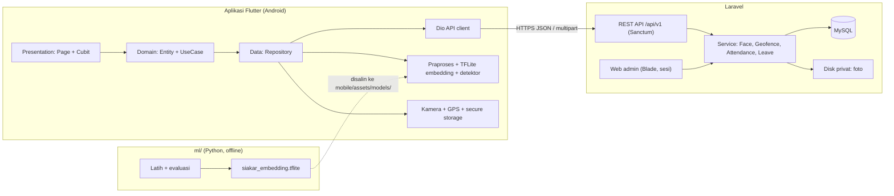
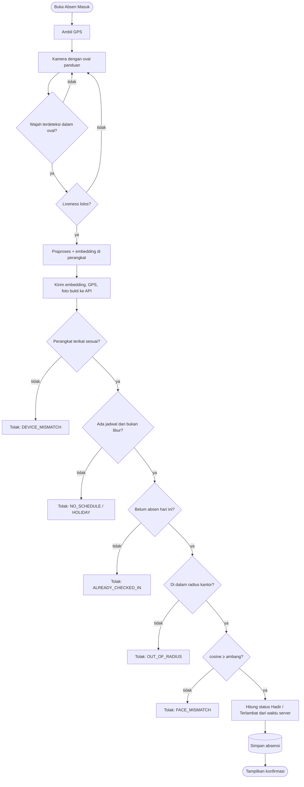
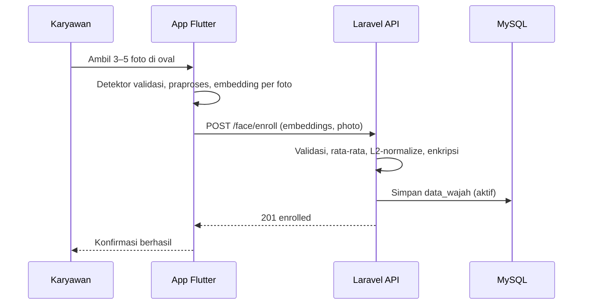

# DESIGN.md — Rancangan Teknis dan UI SIAKAR

Mengikuti `DECISIONS.md`. Bagian 1–5 untuk arsitektur dan data, bagian 6–8 untuk UI/UX.

## 1. Arsitektur Sistem



Prinsip: Python **tidak** berjalan saat aplikasi dipakai; ia hanya menghasilkan model. Embedding dihitung di perangkat; pencocokan dan semua keputusan bisnis di server (D-28, D-60).

## 2. Alur Absen Masuk (flowchart, kebutuhan proposal PM2)



## 3. Urutan Komunikasi: Registrasi Wajah



## 4. Struktur Kode

### 4.1 Flutter (`mobile/`) — Clean Architecture + Cubit

```
mobile/
├── assets/models/                  # siakar_embedding.tflite, detector.tflite, preprocess.json
├── lib/
│   ├── main.dart
│   ├── app/                        # router (go_router), theme, DI (get_it)
│   ├── core/
│   │   ├── config/                 # base url, konstanta, flags
│   │   ├── error/                  # Failure, pemetaan code → pesan
│   │   ├── network/                # Dio client + interceptor
│   │   ├── ml/                     # preprocess (Dart), embedding_service, detector_service, liveness_service
│   │   └── utils/                  # haversine (tampilan), format tanggal
│   ├── design/                     # tokens.dart, app_theme.dart, widget bersama
│   └── features/
│       ├── auth/
│       ├── face_enrollment/
│       ├── attendance/             # beranda absen, check-in/out, riwayat
│       ├── leave/                  # pengajuan izin karyawan
│       └── approval/               # persetujuan + rekap bawahan (atasan)
│           ├── data/               # datasource (remote), model (DTO), repository_impl
│           ├── domain/             # entity, repository (abstract), usecase
│           └── presentation/       # cubit + state, page, widget
└── test/                           # unit (usecase, cubit), parity preprocess, golden vectors
```

Aturan lapisan: `presentation → domain ← data`. Domain tidak mengimpor Flutter/Dio. Cubit hanya memanggil UseCase. Pustaka usulan (cek versi terbaru dengan `flutter pub add`): `flutter_bloc`, `equatable`, `get_it`, `dio`, `go_router`, `flutter_secure_storage`, `camera`, `geolocator`, `permission_handler`, `image`, `tflite_flutter`.

### 4.2 Laravel (`admin/`)

```
admin/
├── app/
│   ├── Http/
│   │   ├── Controllers/Api/V1/      # AuthController, FaceController, AttendanceController, LeaveController, ApprovalController
│   │   ├── Controllers/Admin/       # Karyawan, Departemen, Jabatan, Shift, Jadwal, Lokasi, HariLibur, Absensi, Laporan
│   │   ├── Requests/                # FormRequest per endpoint
│   │   ├── Resources/               # API Resource (bentuk JSON sesuai API.md)
│   │   └── Middleware/              # EnsureRole
│   ├── Models/                      # Pengguna, Karyawan, DataWajah, Shift, JadwalKaryawan, LokasiKantor, Absensi, PengajuanIzin, HariLibur, Departemen, Jabatan
│   ├── Services/                    # FaceMatchService, GeofenceService, AttendanceService, LeaveService
│   └── Support/ApiResponse.php
├── config/face.php                  # threshold, embedding_dim, max_attempts
├── database/{migrations,seeders,factories}
├── resources/views/{layouts,components,admin/*}   # Blade
├── routes/{api.php,web.php}
└── tests/{Unit,Feature}
```

Catatan model: tabel dan kunci bernama Indonesia (`$table`, `$primaryKey`, `$timestamps=false`); `Pengguna` memakai `password_hash` (override `getAuthPassword()`); `HasApiTokens` (Sanctum). Verifikasi bahwa Sanctum bekerja dengan kunci primer `id_pengguna`.

## 5. Skema Basis Data (MySQL)

Sumber: kamus data laporan §7 + penyesuaian `DECISIONS.md` §4.1. Gunakan migrasi Laravel; urutan pembuatan: `departemen`, `jabatan`, `karyawan`, `pengguna`, `data_wajah`, `shift`, `jadwal_karyawan`, `lokasi_kantor`, `absensi`, `pengajuan_izin`, `hari_libur`.

| Tabel | Kolom (PK/FK/UK dicetak tebal) |
|---|---|
| `departemen` | **id_departemen**, nama_departemen |
| `jabatan` | **id_jabatan**, nama_jabatan |
| `karyawan` | **id_karyawan**, **nik (UK)**, nama, jenis_kelamin, tanggal_lahir, email, no_hp, alamat, tanggal_masuk, *id_departemen (FK)*, *id_jabatan (FK)*, *id_atasan (FK → karyawan)*, status_aktif |
| `pengguna` | **id_pengguna**, *id_karyawan (FK)*, **username (UK)**, password_hash, role ENUM(karyawan, atasan, admin), device_id, last_login |
| `data_wajah` | **id_wajah**, *id_karyawan (FK)*, embedding (BLOB/teks terenkripsi), foto_referensi, tanggal_daftar, aktif |
| `shift` | **id_shift**, nama_shift, jam_masuk, jam_pulang, toleransi_menit |
| `jadwal_karyawan` | **id_jadwal**, *id_karyawan (FK)*, *id_shift (FK)*, tanggal (disarankan UK `id_karyawan + tanggal`) |
| `lokasi_kantor` | **id_lokasi**, nama_lokasi, latitude DECIMAL(10,8), longitude DECIMAL(11,8), radius_meter |
| `absensi` | **id_absensi**, *id_karyawan (FK)*, *id_shift (FK, nullable)*, *id_lokasi (FK, nullable)*, tanggal, jam_masuk, jam_pulang, lat_masuk, long_masuk, lat_pulang, long_pulang, foto_masuk, foto_pulang, skor_wajah, status ENUM(hadir, terlambat, izin, sakit, cuti, alpa), keterangan; **UK (id_karyawan, tanggal)**; kolom data wajah/lokasi nullable |
| `pengajuan_izin` | **id_izin**, *id_karyawan (FK)*, *id_penyetuju (FK, nullable)*, jenis ENUM(izin, sakit, cuti), tanggal_mulai, tanggal_selesai, alasan, lampiran, status ENUM(menunggu, disetujui, ditolak), tanggal_pengajuan |
| `hari_libur` | **id_libur**, **tanggal (UK)**, keterangan |

Seeder wajib untuk demo: 1 admin, 1 atasan, beberapa karyawan (dengan `id_atasan`), 1–2 shift, 1 lokasi kantor, jadwal beberapa hari, 1–2 hari libur.

## 6. Design Token (satu sumber untuk Flutter dan Blade)

Selaras dengan template presentasi proyek (navy, hijau, krem). **Ubah di sini dulu**, lalu `tokens.dart` dan `tailwind.config.js`.

### 6.1 Warna

| Token | Hex | Pemakaian |
|---|---|---|
| `primary` | `#338F4A` | Tombol utama, aksen, status sukses |
| `primaryDark` | `#1F6B33` | Tekan/hover tombol utama |
| `navy` | `#1E1E49` | Judul, teks utama, header gelap |
| `background` | `#FFFEF2` | Latar halaman |
| `surface` | `#FFFFFF` | Kartu, input, tabel |
| `surfaceTint` | `#F1F7EF` | Baris tabel selang-seling, hover |
| `outline` | `#CFDDD2` | Garis kartu/tabel |
| `textMuted` | `#5B5B7A` | Teks sekunder |
| `onPrimary` | `#FFFFFF` | Teks di atas primary/navy |

Warna status kehadiran (pakai pasangan latar muda + teks tua agar terbaca):

| Status | Teks/ikon | Latar |
|---|---|---|
| hadir | `#1F6B33` | `#E3F3E7` |
| terlambat | `#9A5B00` | `#FFF1D6` |
| izin / sakit / cuti | `#1F4E8C` | `#E1ECFA` |
| alpa / ditolak / error | `#A32121` | `#FBE3E3` |
| menunggu | `#5B5B7A` | `#ECECF4` |

### 6.2 Tipografi
Keluarga **DM Sans** (tersedia di Google Fonts; bundel sebagai aset agar offline). Skala: `display 32/700`, `title 22/700`, `subtitle 18/600`, `body 16/400`, `label 14/600`, `caption 12/400`. Angka di tabel memakai tabular figures bila tersedia.

### 6.3 Jarak, bentuk, bayangan
Skala jarak kelipatan 4: `4, 8, 12, 16, 24, 32`. Radius: `kartu 12`, `input 10`, `tombol 12`, `chip 999`. Bayangan sangat ringan atau tanpa bayangan dengan garis `outline`. Target sentuh minimum 48 px.

### 6.4 Implementasi bersama

Flutter (`design/tokens.dart`):
```dart
class Tk {
  static const primary = Color(0xFF338F4A);
  static const navy = Color(0xFF1E1E49);
  static const background = Color(0xFFFFFEF2);
  static const surface = Color(0xFFFFFFFF);
  static const outline = Color(0xFFCFDDD2);
  static const radiusCard = 12.0;
}
```
Tailwind (`admin/tailwind.config.js`, bagian `theme.extend`):
```js
colors: { primary: '#338F4A', 'primary-dark': '#1F6B33', navy: '#1E1E49',
          background: '#FFFEF2', surface: '#FFFFFF', tint: '#F1F7EF', outline: '#CFDDD2', muted: '#5B5B7A' },
fontFamily: { sans: ['"DM Sans"', 'system-ui', 'sans-serif'] },
borderRadius: { card: '12px', input: '10px' }
```

## 7. Komponen Bersama

Tombol (utama hijau / sekunder garis / bahaya merah), kartu, input teks dengan label dan pesan error, badge status (§6.1), tabel (header navy, baris selang-seling `tint`), kartu ringkasan angka, state kosong (ilustrasi sederhana + teks), indikator memuat, snackbar/alert. Komponen Blade dan widget Flutter memakai nama konsep yang sama (`StatusBadge`, `SummaryCard`, `AppTextField`, `PrimaryButton`).

## 8. Layar dan Rute

### 8.1 Aplikasi mobile (Karyawan; Atasan menambah tab)

| Rute | Layar | Elemen kunci | Fitur |
|---|---|---|---|
| `/login` | Login | username, password, Masuk | FR-01 |
| `/home` | Beranda | sapaan, tombol Absen Masuk/Pulang, shift hari ini, status hari ini, ringkasan bulan | FR-03/04/05 |
| `/face/enroll` | Registrasi Wajah | panduan, kamera + oval, indikator kualitas/deteksi, tombol Ambil, progres 3–5 foto | FR-02 |
| `/attendance/capture` | Absen | peta/jarak ke kantor, kamera + oval, instruksi liveness, hasil skor, Konfirmasi | FR-03/04 |
| `/attendance/result` | Hasil Absen | status, jam, jarak, skor; alasan penolakan bila gagal | FR-03/04 |
| `/history` | Riwayat | daftar/kalender dengan `StatusBadge`, ringkasan bulan | FR-05 |
| `/leave` | Izin | daftar pengajuan + status | FR-06 |
| `/leave/new` | Ajukan Izin | jenis, tanggal, alasan, lampiran | FR-06 |
| `/profile` | Profil | data diri, perbarui wajah, keluar | FR-01/02 |
| `/approvals` (atasan) | Daftar Pengajuan | pengajuan `menunggu`, tab status | FR-07 |
| `/approvals/:id` (atasan) | Detail Pengajuan | jenis, tanggal, alasan, lampiran, Setujui/Tolak | FR-07 |
| `/team` (atasan) | Rekap Bawahan | filter periode, ringkasan per bawahan | FR-08 |

State Cubit per layar utama: `AuthCubit`, `FaceEnrollmentCubit`, `AttendanceCubit` (today, check-in/out), `HistoryCubit`, `LeaveCubit`, `ApprovalCubit`, `TeamRecapCubit`. Tiap state: `initial / loading / success / failure(Failure)`.

### 8.2 Web admin (Blade)

| Rute | Halaman | Fitur |
|---|---|---|
| `/admin/login` | Login admin | FR-01 |
| `/admin` | Dasbor: kartu ringkasan hari ini (hadir/terlambat/izin/alpa), daftar belum absen | FR-13 |
| `/admin/karyawan` | Tabel + pencarian, tambah/ubah/nonaktifkan, reset wajah & perangkat | FR-10 |
| `/admin/departemen`, `/admin/jabatan` | CRUD kecil | FR-10 |
| `/admin/shift` | CRUD shift | FR-10 |
| `/admin/jadwal` | Jadwal karyawan per tanggal | FR-10 |
| `/admin/lokasi` | CRUD lokasi kantor (koordinat, radius) | FR-10 |
| `/admin/hari-libur` | CRUD hari libur | FR-11 |
| `/admin/absensi` | Pencarian, ubah status, keterangan wajib | FR-12 |
| `/admin/laporan` | Filter periode/departemen/karyawan, tabel rekap, ekspor CSV | FR-13/14 |

Layout: sidebar navy + konten krem; tabel dengan pagination server-side dan pencarian; form dengan validasi server dan pesan error per field; komponen Blade dipakai ulang (`x-table`, `x-form-field`, `x-status-badge`, `x-card`).

## 9. Aturan Antarmuka Kamera/Oval

- Oval panduan di tengah layar; rasio dan posisi crop **diambil dari `preprocess.json`** (satu sumber dengan Python).
- Instruksi singkat di atas oval: "Posisikan wajah di dalam bingkai", "Cahaya kurang terang", "Tahan sebentar".
- Tombol ambil aktif hanya saat detektor menyatakan wajah ada di dalam oval.
- Pratinjau tidak disimpan; hanya foto bukti yang dikirim saat absen.
- Semua izin kamera/lokasi diminta kontekstual dengan penjelasan satu kalimat; penolakan ditangani dengan layar bantuan.
